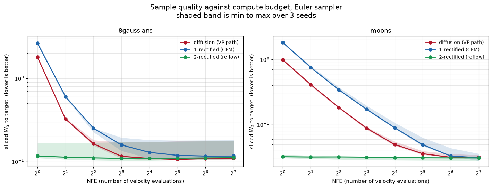
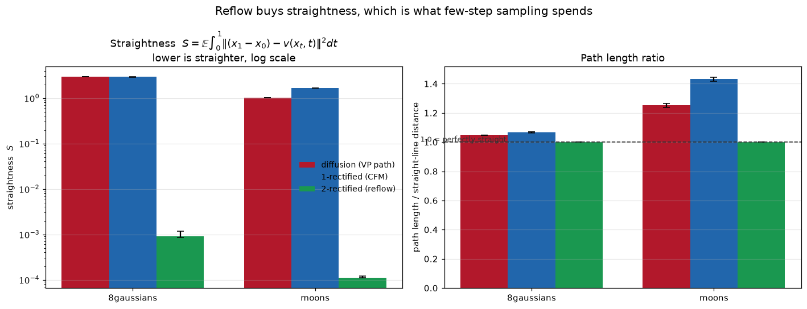
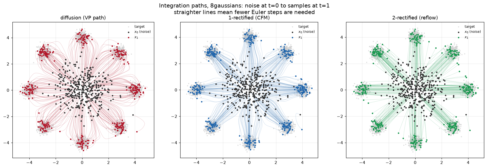
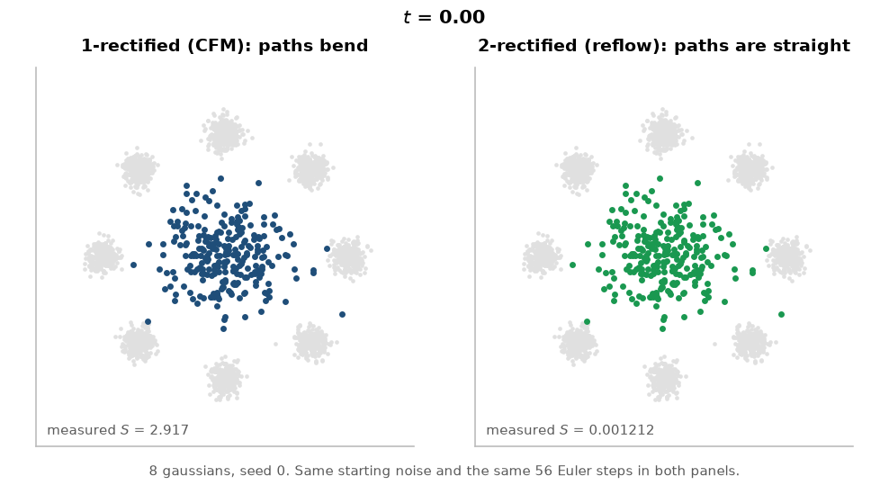
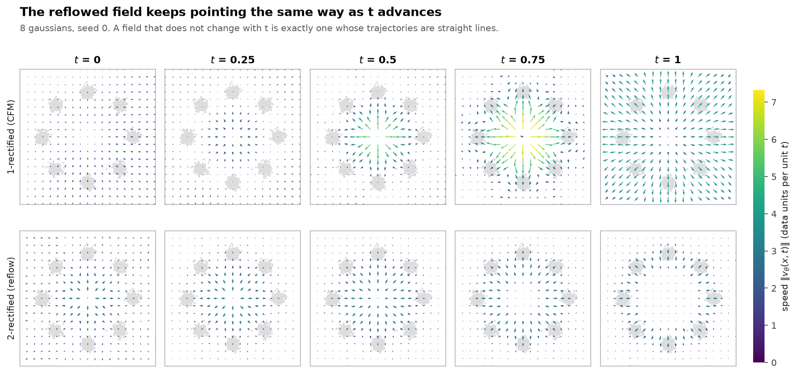
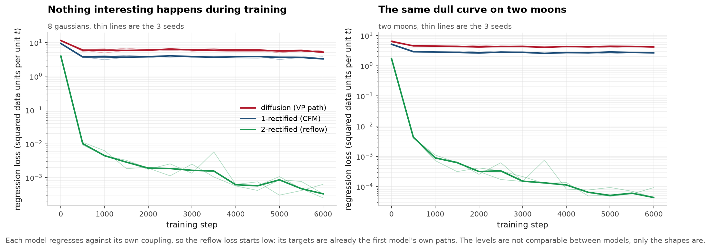

# One Euler step, if you straighten the paths first

[](https://github.com/aghasalim/rectified-flow-from-scratch/actions/workflows/ci.yml)
[](https://www.python.org/)
[](LICENSE)
[](results/)
[](https://doi.org/10.5281/zenodo.23003668)

I built conditional flow matching, rectified flow and reflow from the papers. I
also measured how straight the sampling paths are, and that number ended up
explaining most of what I saw.

Everything below ran on my laptop CPU (Apple M4). The whole results table took
471 s of compute, about 8 minutes, which I logged in
[results/run-meta.json](results/run-meta.json). I also rebuild every number from
the committed CSVs in `verify/`, using C, Java, Rust, Go, SQL, R and JavaScript.
None of those can see the Python that made the numbers, and the build only goes
green when they all agree.

## The one result

With enough compute, all three models end up with about the same sample
quality. The reflowed one is the only one that still works with a single step.

**8 gaussians**, sliced Wasserstein-2 to the target (lower is better), median of
3 seeds, Euler sampler:

| NFE | diffusion (VP) | 1-rectified (CFM) | 2-rectified (reflow) |
|---:|---:|---:|---:|
| 1 | 1.796 | 2.639 | **0.117** |
| 2 | 0.324 | 0.601 | **0.113** |
| 4 | 0.164 | 0.252 | **0.111** |
| 8 | 0.116 | 0.159 | **0.110** |
| 128 | 0.110 | 0.117 | 0.112 |

**two moons**, same protocol:

| NFE | diffusion (VP) | 1-rectified (CFM) | 2-rectified (reflow) |
|---:|---:|---:|---:|
| 1 | 0.988 | 1.821 | **0.032** |
| 2 | 0.412 | 0.757 | **0.032** |
| 4 | 0.184 | 0.343 | **0.032** |
| 8 | 0.088 | 0.172 | **0.032** |
| 128 | 0.032 | 0.031 | 0.031 |

At 1 NFE the reflowed model does as well as it does at 128 NFE. On moons that
cuts sampling cost by 128x with no loss I could measure. It's the flat green
line in the plot below.



## Why it works, measured

It comes down to how straight the paths are. If a trajectory is a straight line,
one Euler step integrates it exactly, since the velocity stays the same along the
path. If it curves, one step cuts the corner and lands in the wrong place.

I measure straightness with

    S = E integral from 0 to 1 of || (x1 - x0) - v(x_t, t) ||^2 dt

where x1 is the endpoint the model's own ODE reaches. I don't use an independent
data sample there. S is zero only when every trajectory is straight.

| dataset | model | S | path length / straight line |
|---|---|---:|---:|
| 8gaussians | diffusion (VP) | 2.934 | 1.048 |
| 8gaussians | 1-rectified | 2.927 | 1.066 |
| 8gaussians | 2-rectified | **0.00099** | **1.00006** |
| moons | diffusion (VP) | 1.012 | 1.245 |
| moons | 1-rectified | 1.661 | 1.433 |
| moons | 2-rectified | **0.00011** | **1.00006** |

Reflow lowers S by about 3000x on 8 gaussians and about 15000x on moons. The path
length ratio goes to 1.00006, so the trajectories are straight to five decimal
places.



You can also just plot the paths and see it.



It's even easier to see when the paths are animated.



*Both panels start from the same noise sample and take the same 56 Euler steps
toward the same target. Only the velocity field is different. The left one is
plain flow matching, and the right one is the same model after one round of
reflow.*

## What reflow actually does

Plain conditional flow matching draws x0 from noise and x1 from data
independently. Each pair gets a straight conditional path, but paths from
different pairs cross. At a crossing the model can only learn one velocity, so it
learns the average of the two. Reflow leaves the model alone and changes the
pairing. You integrate the trained model from lots of noise samples, keep the
(x0, x1) pairs it produced, and retrain on those. Now x0 to x1 is a function, so
no paths cross and nothing gets averaged away. That's what takes S on 8
gaussians from 2.927 to 0.00099.



Full detail in [notes/METHODS.md](notes/METHODS.md#what-reflow-actually-does).

## The cost

Reflow has a cost, and you can see it in the last row of the tables above. At
128 NFE on 8 gaussians the reflowed model scores 0.112, and the model it was
distilled from scores 0.117. Both are medians of 3 seeds. The reflowed number is
lower, but the seeds run 0.107 to 0.176 for it and 0.110 to 0.181 for its teacher,
so I'd call them level. Since it's trained on its own teacher's outputs, it can't
really get ahead of it. In the end reflow gives up some of the ceiling to raise
the floor.

Full detail in [notes/METHODS.md](notes/METHODS.md#the-cost).

## Training

Training is just a regression against the interpolant slope. There's no ELBO,
score function or noise schedule. The loss curves are boring, which is what I
wanted to see.



The run that drew them is the last entry in [notes/LOGBOOK.md](notes/LOGBOOK.md),
with every setting and seed and the line that set it.

## What I got wrong

My diffusion control ran backwards for a whole experiment. I wrote `VPPath` with
the convention from the diffusion papers, where t=0 is data and t=1 is noise.
`LinearPath` and every sampler in the repo use t=0 for noise. So the model learned
a field pointing from data to noise and then got integrated the wrong way.
Nothing crashed and nothing went NaN. It just made a plausible looking blob. What
gave it away was the sliced W2 getting worse with more compute. In that broken
run it was 2.43 at 1 NFE and 2.84 at 128. I was missing an obvious test, that
t=0 is the noise end, and now it runs over every path class.

I wrote up the whole thing, including how long it took me to notice, in
[notes/METHODS.md](notes/METHODS.md#what-i-got-wrong).

## Running it

```bash
python -m venv .venv && source .venv/bin/activate
pip install -r requirements.txt
```

```bash
python -m pytest tests/ -q
```

```bash
python -m bench.experiment --datasets 8gaussians moons --seeds 0 1 2 --steps 6000
```

```bash
python -m bench.figures
```

The experiment takes about 8 minutes on an M4 CPU and writes `results/*.csv` plus
the model checkpoints. `bench.figures` only reads those files and never re-runs
an experiment, so a figure can't disagree with a number in this README.

## Layout

```
fm/paths.py         linear and VP interpolants, and their velocity targets
fm/models.py        MLP velocity field with sinusoidal time embedding
fm/samplers.py      Euler, Heun, RK4, each reporting its own NFE
fm/straightness.py  the S metric
fm/train.py         the CFM training loop
fm/reflow.py        builds the model's own coupling
fm/toys.py          8 gaussians, moons, spiral, checkerboard
bench/experiment.py trains everything and writes the CSVs
bench/figures.py    all figures and the animation, from committed CSVs only
tests/              30 tests
verify/             the same numbers recomputed in C, Rust, Java, Go, SQL and JavaScript
```

## Sources

These are the papers I built this from, and what I used each one for.

- **Lipman, Chen, Ben-Hamu, Nickel, Le. Flow Matching for Generative Modeling. ICLR 2023.** [arXiv:2210.02747](https://arxiv.org/abs/2210.02747) The conditional flow matching objective, and the argument that you can regress against a conditional path and still get the right marginal field.
- **Liu, Gong, Liu. Flow Straight and Fast: Learning to Generate and Transfer Data with Rectified Flow. ICLR 2023.** [arXiv:2209.03003](https://arxiv.org/abs/2209.03003) Rectified flow and the reflow procedure. The crossing-paths argument in the section above is theirs.
- **Albergo, Vanden-Eijnden. Building Normalizing Flows with Stochastic Interpolants. ICLR 2023.** [arXiv:2209.15571](https://arxiv.org/abs/2209.15571) The interpolant framing that makes diffusion and flow matching two choices of the same object.
- **Tong et al. Improving and Generalizing Flow-Based Generative Models with Minibatch Optimal Transport. TMLR 2024.** [arXiv:2302.00482](https://arxiv.org/abs/2302.00482) Minibatch OT coupling, which attacks the same crossing problem reflow does but during training; reflow does it afterwards.
- **Ho, Jain, Abbeel. Denoising Diffusion Probabilistic Models. NeurIPS 2020.** [arXiv:2006.11239](https://arxiv.org/abs/2006.11239) The VP path used as the control arm here.
- **Song, Sohl-Dickstein, Kingma, Kumar, Ermon, Poole. Score-Based Generative Modeling through SDEs. ICLR 2021.** [arXiv:2011.13456](https://arxiv.org/abs/2011.13456) The probability flow ODE, which is why a diffusion model can be sampled with the same ODE solvers used here.

Sliced Wasserstein as a distance between point clouds follows **Bonneel, Rabin, Peyré, Pfister, Sliced and Radon Wasserstein Barycenters of Measures, JMIV 2015**.

## Methodology

Three of the rules in [`METHODOLOGY.md`](METHODOLOGY.md) mattered a lot on this
project. I build the simple, readable version first. Without it the VP control
could have run backwards for a week with nothing to catch it. I publish the seed
spread, otherwise the last row of the NFE table looks like a win when it's a tie.
And I keep negative results in, which is why the section on what reflow costs
exists.

## License

Released under MIT; see [LICENSE](LICENSE).
